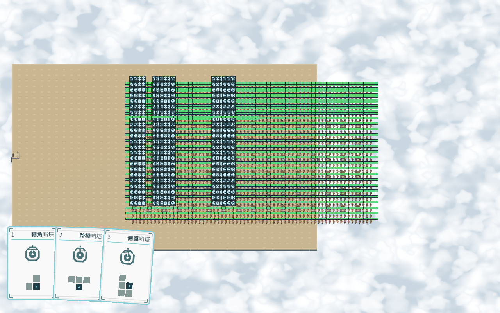

# Windows／Web 極端負載實測（2026-10-20）

目前在本機的合成壓力場景中，數千敵人可完成測試，但幀率已不可玩。主要成本是大量頭頂狀態繪製、逐隻顯示更新，以及密集戰鬥。大型路網／多入口規劃還會產生可見的同步停頓。這次新增測試與報告，未調整遊戲平衡或執行邏輯。

## 執行環境與方法

- CPU：AMD Ryzen 5 4600H with Radeon Graphics，12 個邏輯處理器；RAM：7.4 GiB。
- Windows：Windows 11 Home；Godot 4.7.2-stable (official)，Compatibility／NVIDIA GeForce RTX 3050 Laptop GPU。
- Web：Edge 155.0.4283.62，WebGL 2、單執行緒、release 匯出；繪圖裝置：ANGLE (AMD, AMD Radeon(TM) Graphics (0x00001636) Direct3D11 vs_5_0 ps_5_0, D3D11)。
- Web 獨顯對照：同一份 Web build，以 browser launch option 要求高效能 GPU；實際裝置 ANGLE (NVIDIA, NVIDIA GeForce RTX 3050 Laptop GPU (0x000025A2) Direct3D11 vs_5_0 ps_5_0, D3D11)。原始預設內顯數據另保留，不能將兩 GPU 差異歸因於平台。
- 解析度 1280×800。Windows 使用 editor runtime＋debug GDExtension，Web 使用 release runtime＋release GDExtension；因此這是各自實際執行環境的量測，不是相同建置的純平台速度比較。瀏覽器為 headless，同前景互動視窗可能有差異。
- 尋路每案 1 次暖機、3 次量測，列平均。包括原生建圖、三兵種候選與機率表、1,024 次配額分配及 BFS。plans 包含 prepare、合成評分陣列與候選物化；graph 不含 GridMap → packed snapshot 的轉換。
- 逐幀測試呼叫現有移動、戰鬥、MultiMesh／避讓與特效系統，以固定 1/60 秒（4x 為 4/60）工作量步進，並實際繪製地圖、雲、模型及 UI。30 幀暖機後測 60–180 幀；量測超過 6 秒且至少 60 幀時結束。
- FPS = 1000／平均 wall 幀間隔，包含繪製及主迴圈；Web 的 rAF／VSync 可限制最高幀率。這不是 GPU timer，也不是完整正式關卡的即時模擬或長時間遊玩。
- 執行期場景為 41×33 的合成寬地形；敵人使用高血量與低速直線行程以維持固定人口，戰鬥測試每塔間隔 0.1 秒，四分之一使用附減速的 AOE。塔位直接建立，排除放置／地圖重建成本。純敵群使用 Soldier 批次模型，混合案例使用三兵種目前各自模型。
- 不預先 reserve 的同幀生成用於壓測實例建立及容量擴張，列出一次性耗時；正式 Wave 會先 reserve，且一般分批出生，因此不能把此值等同正常開波停頓。

## 逐幀結果

| 負載 | Windows RTX FPS | Windows P95 ms | Web RTX FPS | Web RTX P95 ms | Web AMD FPS | Web AMD P95 ms |
| --- | ---: | ---: | ---: | ---: | ---: | ---: |
| 128 隻，血條開 | 131.3 | 9.8 | 66.5 | 18.8 | 49.9 | 23.9 |
| 512 隻，血條開 | 42.1 | 34.1 | 20.6 | 64.7 | 16.1 | 85.2 |
| 2,048 隻，血條開 | 11.1 | 128.6 | 5.5 | 245.1 | 4.3 | 293.5 |
| 4,096 隻，血條開 | 5.8 | 272.4 | 2.5 | 545.4 | 2.3 | 629.3 |
| 4,096 隻，同點擁擠 | 6.0 | 201.9 | 2.7 | 493.3 | 2.3 | 530.9 |
| 2,048 隻，血條關 | 35.0 | 70.5 | 27.4 | 95.4 | 22.2 | 108.4 |
| 2,048 隻＋128 塔，1x | 8.5 | 159.4 | 3.0 | 340.1 | 2.9 | 343.7 |
| 2,048 隻＋128 塔，4x | 7.7 | 160.5 | 3.5 | 400.4 | 2.9 | 471.3 |
| 256 隻，三兵種混合模型 | 61.5 | 20.4 | 31.7 | 44.7 | 27.8 | 45.4 |

60 FPS 的預算為 16.7 ms／幀，30 FPS 為 33.3 ms／幀。P95 表示 95% 的量測幀不超過該值。不能由本表宣稱一個跨硬體通用的敵人數量上限。

## 尋路與連通性

| 路網 | 道路格／入口節點 | Windows 建圖 ms | Windows 三兵種規劃 ms | Web AMD 建圖 ms | Web AMD 規劃 ms | Web RTX 規劃 ms |
| --- | ---: | ---: | ---: | ---: | ---: | ---: |
| wide_50_budget64_origins1 | 2500／2 | 2.7 | 24.9 | 2.7 | 27.1 | 20.6 |
| wide_100_budget64_origins1 | 10000／2 | 12.8 | 80.3 | 7.0 | 53.0 | 53.3 |
| lattice_21_budget64_origins1 | 341／119 | 1.3 | 23.9 | 1.3 | 26.8 | 24.4 |
| lattice_41_budget64_origins1 | 1281／439 | 4.0 | 47.1 | 4.1 | 54.0 | 55.1 |
| lattice_41_budget256_origins1 | 1281／439 | 6.0 | 163.0 | 3.3 | 165.0 | 163.5 |
| lattice_21_budget64_origins8 | 341／123 | 1.1 | 170.2 | 1.2 | 163.7 | 159.2 |

origins8 每輪實際建立 8 入口 × 3 兵種＝24 份計畫。寬路案例為 50×50／100×100 滿格；lattice 每隔一格挖洞，保留大量環與岔路。budget256 是高搜尋預算壓測，未改正式設定。

## 成本分解與瓶頸

| 案例 | 平台 | 移動 ms | 戰鬥 ms | 批次顯示 ms | 特效提交 ms | Draw calls |
| --- | --- | ---: | ---: | ---: | ---: | ---: |
| 2,048 隻，血條開 | Windows RTX | 4.8 | 0.0 | 22.1 | 0.0 | 4311 |
| 2,048 隻，血條開 | Web AMD | 5.6 | 0.0 | 31.9 | 0.0 | 4311 |
| 2,048 隻，血條開 | Web RTX | 4.7 | 0.0 | 28.9 | 0.0 | 4311 |
| 2,048 隻，血條關 | Windows RTX | 4.5 | 0.0 | 21.8 | 0.0 | 215 |
| 2,048 隻，血條關 | Web AMD | 5.5 | 0.0 | 34.1 | 0.0 | 215 |
| 2,048 隻，血條關 | Web RTX | 4.4 | 0.0 | 28.5 | 0.0 | 215 |
| 2,048 隻＋128 塔，1x | Windows RTX | 4.8 | 11.7 | 23.2 | 4.4 | 5720 |
| 2,048 隻＋128 塔，1x | Web AMD | 5.7 | 14.1 | 30.7 | 5.3 | 5720 |
| 2,048 隻＋128 塔，1x | Web RTX | 5.2 | 14.6 | 32.0 | 5.5 | 5720 |
| 2,048 隻＋128 塔，4x | Windows RTX | 4.3 | 12.0 | 38.9 | 3.4 | 5648 |
| 2,048 隻＋128 塔，4x | Web AMD | 6.4 | 18.1 | 64.5 | 5.0 | 5648 |
| 2,048 隻＋128 塔，4x | Web RTX | 5.4 | 16.5 | 61.2 | 4.7 | 5648 |
| 256 隻，三兵種混合模型 | Windows RTX | 0.6 | 0.0 | 4.2 | 0.0 | 1577 |
| 256 隻，三兵種混合模型 | Web AMD | 0.9 | 0.0 | 6.5 | 0.0 | 1577 |
| 256 隻，三兵種混合模型 | Web RTX | 0.8 | 0.0 | 5.9 | 0.0 | 1577 |

- 頭頂狀態是優先瓶頸：關閉血條的對照同時移除其繪圖及更新。單一 Control 不代表單一 draw call；目前每隻 StyleBox／彩色矩形／效果圖示仍形成大量繪製工作。上表分段計時不包含 Control._draw，成本會出現在整體 wall 時間。
- MultiMesh 模型已合批，但 GDScript 仍逐隻計算姿態、轉換並提交 instance 資料。若要支持數千敵人，下一步應量測整批 buffer 提交、共用 transform 快取，以及狀態條幾何合批的收益。
- 4,096 隻同點擁擠與分散案例的時間同量級；此負載未顯示避讓退化為全 pair 比較。這只是目前取樣的觀察，不取代演算法複雜度驗證。
- 同步規劃會超過一個幀預算。應先處理增量／分幀規劃或降低重算範圍；任何改動仍須在目前 revision 的規劃完成後才能開波，且保留已鎖定行程。
- 目前混合模型與純 Soldier 的敵人數不同，只能各自評估負載；不可據此量化模型選擇造成的百分比差異。

Web 1x 密集戰鬥案例出現長幀：內顯 5056.1 ms、RTX 5756.4 ms，已保留原始樣本與平均值。手動計時的移動／戰鬥／批次／特效提交均沒有同量級尖峰，停頓主要位於這些區段之外；首次繪製或瀏覽器／驅動停頓仍需另行追查，不能直接判定原因。

## 突發生成與記憶體

| 負載 | Windows 同幀生成 ms | Web 同幀生成 ms | Windows Godot static MiB | Web Godot static MiB |
| --- | ---: | ---: | ---: | ---: |
| 128 隻，血條開 | 223.8 | 23.4 | 95.4 | 不提供 |
| 2,048 隻，血條開 | 3115.7 | 253.2 | 113.9 | 不提供 |
| 4,096 隻，血條開 | 6336.0 | 502.8 | 133.7 | 不提供 |
| 2,048 隻＋128 塔，1x | 3927.5 | 238.7 | 121.1 | 不提供 |

static memory 僅為 Godot 追蹤的配置，排除 GPU、瀏覽器 JS／Wasm 保留 heap、程序 RSS 與峰值，不能當作遊戲總記憶體。Web release 的 monitor 回傳 0，視為不提供，不能解讀為零記憶體。此測試未做長時間 soak／反覆切關的洩漏驗證。

## 正確性與範圍

- Windows／Web 六案的道路格、節點、各計畫候選數及 1,024 次分配指紋一致；BFS 可連通全部入口，所有計畫與分配非空。各執行期案例人口保持固定；密集戰鬥確實產生攻擊與投射物。
- Windows 測試 failures=0；Web failures=0、console/page errors=0。
- Web RTX 對照 failures=0、console/page errors=0，亦通過 Windows 路網結構及分配指紋比對。
- 匯出工具出現一次 ObjectDB instance leaked at exit 警告；發生於 editor 匯出退出，Windows 執行期及 Web 測試沒有對應錯誤。尚未對此單獨追查。
- 未測 Windows standalone release、前景瀏覽器互動、手機／低階 GPU、完整正式關卡的 4x 到期出生追趕、死亡特效風暴或長時間記憶體穩定性；本次結果不涵蓋這些情境。

## 重現與原始資料

1. 在專案根目錄，以 Godot 4.7.2 的一般渲染模式執行 `res://tests/performance/extreme.tscn`，將 stdout 保存到 `.godot/extreme_windows.out`；不要用 headless Windows 幀率作比較。
2. 執行 `tools/benchmarks/export_extreme.ps1 -Godot <Godot執行檔>`，產生 `.godot/extreme_web/index.html`。需對應 Web GDExtension export template；工具完成或失敗都會還原主場景與匯出設定。
3. 設定 `PLAYWRIGHT_MODULE`、`BENCHMARK_PYTHON`、`BENCHMARK_BROWSER`，執行 `node tools/benchmarks/benchmark_extreme.cjs`；再加 `--high-performance-gpu` 執行第二輪，並核對 WebGL renderer 是否為預期獨顯。
4. 執行 `node tools/benchmarks/summarize_extreme.cjs` 更新本報告。

[Windows 原始結果](extreme_windows.json)／[Web 預設 GPU](extreme_web.json)／[Web RTX 對照](extreme_web_discrete.json)。JSON 保存每幀樣本、P50／P95／P99、各階段時間、結構與機器資訊。

