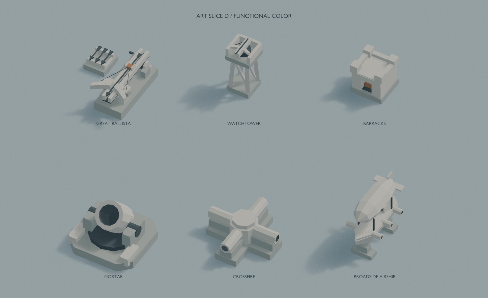
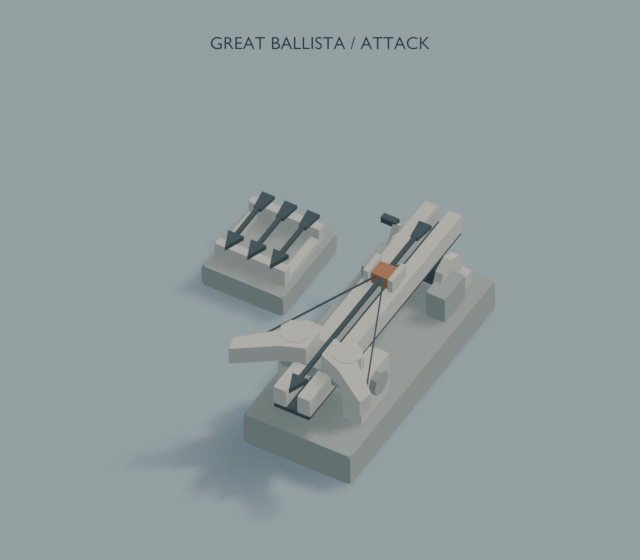
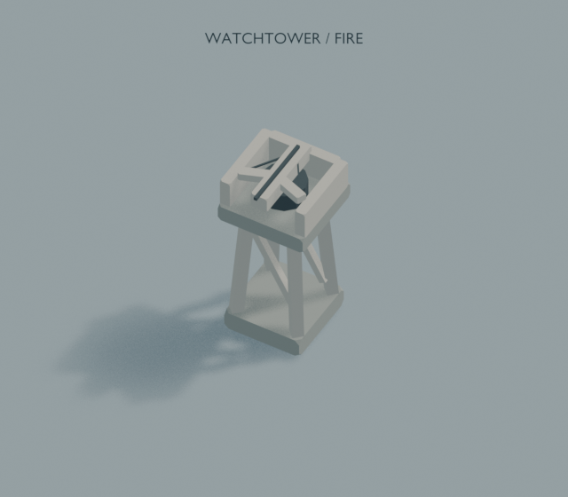
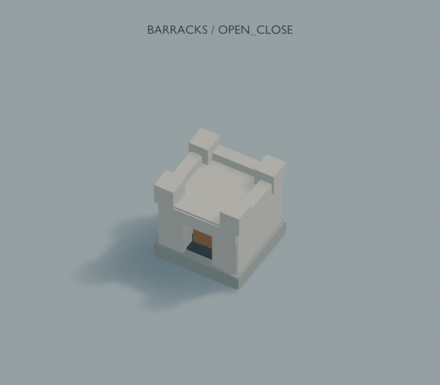
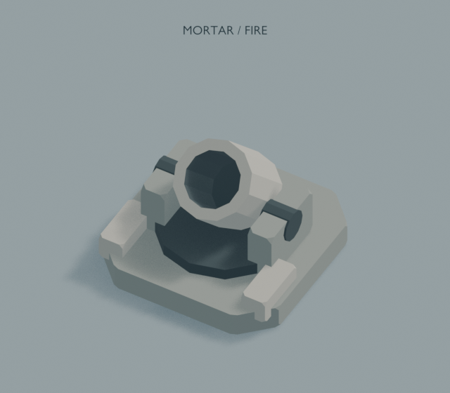
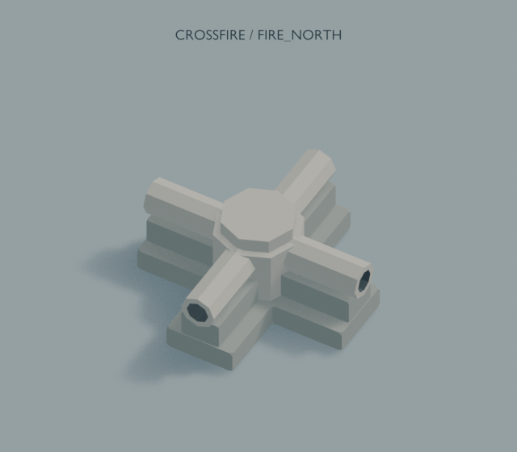
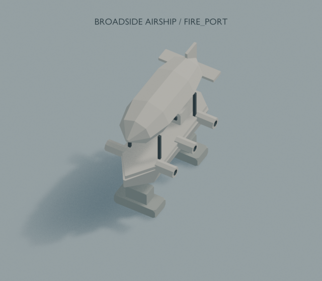

# Art Slice D

[規格與接入說明](model-spec.md)

## Great Ballista

[Blender](great_ballista/model.blend) · [Python](great_ballista/build.py)

[attack 關鍵影格](great_ballista/previews/attack_keyframes.png)

## Watchtower

[Blender](watchtower/model.blend) · [Python](watchtower/build.py)

[fire 關鍵影格](watchtower/previews/fire_keyframes.png)

## Barracks

[Blender](barracks/model.blend) · [Python](barracks/build.py)

[open_close 關鍵影格](barracks/previews/open_close_keyframes.png)

## Mortar

[Blender](mortar/model.blend) · [Python](mortar/build.py)

[fire 關鍵影格](mortar/previews/fire_keyframes.png)

## Crossfire

[Blender](crossfire/model.blend) · [Python](crossfire/build.py)

[fire_north 關鍵影格](crossfire/previews/fire_north_keyframes.png)

[fire_east 關鍵影格](crossfire/previews/fire_east_keyframes.png)

[fire_south 關鍵影格](crossfire/previews/fire_south_keyframes.png)

[fire_west 關鍵影格](crossfire/previews/fire_west_keyframes.png)

## Broadside Airship

[Blender](broadside_airship/model.blend) · [Python](broadside_airship/build.py)

[fire_port 關鍵影格](broadside_airship/previews/fire_port_keyframes.png)

[fire_starboard 關鍵影格](broadside_airship/previews/fire_starboard_keyframes.png)
