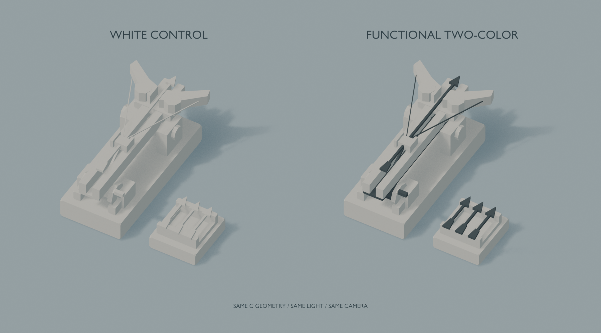
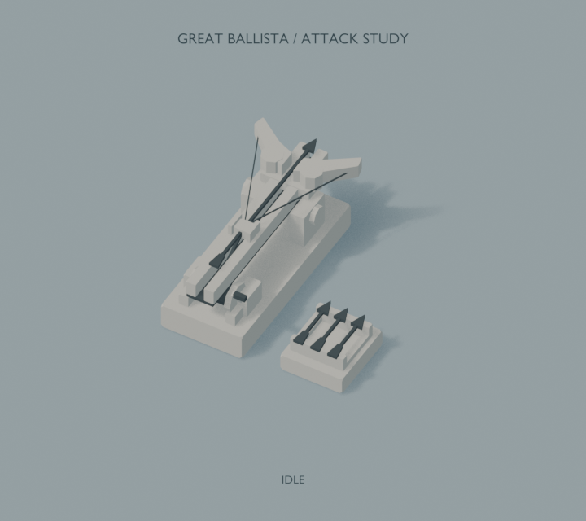

# Great Ballista C — 第二輪上色與攻擊預覽

2026-11-04，以第一輪 C / Detailed 的 `.blend` 為來源，透過 Blender MCP 製作與檢視。這仍是獨立視覺驗證；沒有接入 Godot、修改戰鬥或新增特效系統。

## 直接觀看





[30°靜態圖](previews/static_30.png) · [120°靜態圖](previews/static_120.png) · [六個關鍵姿態](previews/attack_keyframes.png) · [遊戲尺度動畫](previews/attack_game_scale.png) · [遊戲尺度靜態](previews/game_scale.png)

APNG 動畫可在支援的圖片預覽／瀏覽器循環播放；六格圖提供同一循環的靜態對照。`model.blend` 的 Hero／Attack／Game 場景亦可直接播放1–72幀。

## 模型與配色

- 直接讀取 `../great_ballista_slice/exports/great_ballista_c.blend` 的模型 collection。原檔保留；同一份46個mesh、1,352三角形，沒有新增幾何細節、骨架或變形網格。
- 保持 L 形 `(0,0),(0,1),(1,1)`：兩格主武器＋右後一格箭架，錨點0；Blender +Y／Godot −Z為發射方向。待機尺寸仍為1.78×1.905×0.80，根比例1。
- 主色 `#DFD9CE`（淺暖灰白）、功能深色 `#465155`；兩份常量PBR材質、粗糙度0.88、非金屬、不透明。無貼圖、噪聲、磨損、發光或第三色。預覽背景／道路色不屬於模型色盤。
- 本輪沿用 C 原有的兩色思路，略提亮主色，並將真正的箭軌槽底分配到深色。圖中的 WHITE CONTROL 是本輪額外建立的全淺色對照，不表示第一輪 C 原本完全沒有深色。
- 深色只用在箭、弓弦、槽底與原有絞盤／軸接等功能件。弓臂、支架和底座保持同一主色，主要輪廓沒有改成多色拼塊。

## 攻擊循環

| 階段 | 幀 | 表現 |
| --- | --- | --- |
| Idle | 1–8 | 帶箭待機，底座固定 |
| Wind-up / Hold | 9–29 | 滑塊與箭後拉0.24格，弓臂最大5°微動；弓弦端點跟隨 |
| Fire | 30–33 | 箭沿+Y射出，弓臂迅速釋放，上部最多後座0.07格 |
| Recover | 34–54 | 上部較慢回位，底座與裝填區不彈跳；箭飛離後隱藏 |
| Reload / Idle | 55–72 | 第59幀補回待機箭，65幀起回到穩定待機 |

Blender72幀、24fps，共3秒。新增Slider、BoltCarrier與兩個LimbPivot四個Empty控制；使用物件位置／旋轉與弓弦長度的逐幀烘焙關鍵影格，無骨架、rig外掛、執行期handler或第三方依賴。左右弓臂受力時在軸座遮蓋內向內讓位最多0.012格，避免拉弦時外擴越格。絞盤連桿連接固定端與滑塊，後座時不跟著固定端漂移。

箭在飛行與補回之間，同時設定 render／viewport 可見性。補箭採預覽用的歸位重新顯示，未模擬小人搬運、真實上膛或戰鬥彈藥；本輪也沒有音效、閃光、拖尾或命中特效。這3秒是視覺節奏，不改寫正式攻擊間隔。

## 視角與分析

俯角45°、主方位30°，補查120°。鏡頭垂直跨度依 view_frame 校正，靜態圖1100×1000／3.35；近景動畫720×640／4.25；遊戲尺度1280×800／18.5，模型沒有因為畫面空而放大。動畫APNG採12fps取樣，保留原3秒時序，像素不重採樣。背景道路只是顯示用的簡單尺度參考。

- **配色**：相同幾何／光照下，深色清楚勾出弓弦三角形、箭頭與發射軸；暖灰白仍占大部分面積。槽底加深有助於讀出兩條軌道的間隙，側面也能看出機械層次。
- **動態**：蓄力後短暫停頓、快速箭離軌與較慢回位，提供比單純位移更明確的重量節奏。底座穩定，沒有縮放整個武器或誇張彈跳。
- **遊戲尺度**：箭射出與滑塊前後變化比微小弓臂旋轉更容易辨認；0.07格後座約為數個像素，適合當次要回饋。微動不能取代巨弓剪影，深色箭／弦在此比新增細節更有用。
- **下一步建議**：保留目前兩色與主比例。若需更強遠景回饋，先調整蓄力停頓／發射時間差，再考慮小幅調整槽底的可見寬度；不急於增加第三色、細節或特效。當前鏡頭下不需要再增大底座或弓體。

Blender EEVEE／AgX沿用第一輪的統一背景及暖方向光，只作構圖、功能層次與動畫驗證；尚未證明與 Godot Compatibility 的實際材質／陰影相同。

## 檔案與重跑

- [model.blend](model.blend)：五個獨立場景 Hero、Alternate、Attack、Game、ColorComparison，含完整烘焙動畫；不需腳本也能播放。
- [build.py](build.py)：複製C、兩色指派、pivot／動畫、展示場景與渲染。重建依賴相鄰第一輪 `build.py` 及上述C原始檔；交付zip包含這兩個確切來源。
- [make_media.py](make_media.py)：Python標準庫製作無損APNG與六格圖；使用差異矩形減少檔案大小，沒有改變渲染像素。
- [inspection.json](inspection.json)、[animation-check.json](animation-check.json)、[media-check.json](media-check.json)：本次幾何／動畫／媒體檢查。

在專案根目錄執行（本機路徑）：

```powershell
$blender = 'C:/Program Files/Blender Foundation/Blender 5.2/blender.exe'
$round2 = 'D:/games/begins-with-a-road-routing/tools/assets/blender/great_ballista_round2'
& $blender --background --python "$round2/build.py" -- --build --finalize
& $blender --background "$round2/model.blend" --python "$round2/build.py" -- --render-stills
& $blender --background "$round2/model.blend" --python "$round2/build.py" -- --render-animation
& 'C:/Users/USER/AppData/Local/Python/pythoncore-3.14-64/python.exe' "$round2/make_media.py"
```

Live MCP亦可用檔頭方式執行build，再用 `--finalize` 將隔離scene library保存為可正常開啟的.blend；這一步只接受本輪的model.blend，不保存使用者原工作檔。重建只清理 `BWAR_GB2_`，保留第一輪與原本Scene。

## 本次核對

- 重建後維持138個本輪物件（含白模對照與展示元件）、11份本輪動作、46個正式模型mesh／1,352三角形；無重複累積，非本輪物件世界變換保持不變，第一輪C來源hash未變。
- 72幀逐幀檢查：除飛行箭外的footprint越界0、逐mesh非流形邊0、非正變換行列式0；第72幀與第1幀全部模型矩陣最大差0。飛行箭刻意離開建築占地，不屬於塔體。
- 近景／遊戲APNG各36幀、12fps、3秒；CRC、序號、patch邊界與時序通過，六個取樣幀無損重建後與原渲染像素完全一致。六格圖包含待機／拉弦／發射／回位／補箭／循環待機。
- 真實靜態／動態渲染完成，Blender原始檔重新開啟完成，MCP姿態檢視完成。原始連續PNG與log留在忽略的 `.godot/`，只保留指定交付圖與動畫。
- 未執行Godot／Web／效能或正式戰鬥驗收；未建立本輪GLB、未套用共用solid_color的CUSTOM通道。使用者本輪允許只在Blender完成品質判斷，沒有強行接入正式遊戲。
