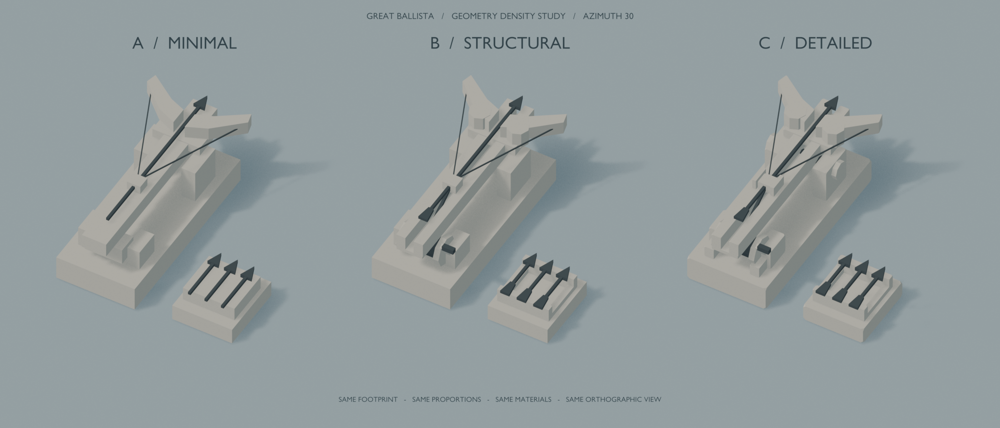

# Great Ballista — 第一輪 Art Slice

製作／核對：2026-11-04。依 `$bwar-modeling`，以 Blender MCP + Blender Python 製作；本輪不接入 Godot、不改遊戲資料／邏輯、不製作攻擊動畫。

## 直接比較



| 版本 | Blender | 獨立預覽 | 三角形 | 差異 |
| --- | --- | --- | --- | --- |
| A Minimal | [A](exports/great_ballista_a.blend) | [A 預覽](previews/a_minimal.png) | 276 | 單體箭軌、簡化支架／絞盤／箭架，保留弓臂與弓弦 |
| B Structural | [B](exports/great_ballista_b.blend) | [B 預覽](previews/b_structural.png) | 548 | 真正開放箭槽、弓臂座、絞盤／張力連桿／曲柄、鏤空箭架與箭羽 |
| C Detailed | [C](exports/great_ballista_c.blend) | [C 預覽](previews/c_detailed.png) | 1,352 | 保留 B 的比例與零件配置，加入一段切角、橫軸與軸套、扳機／絞盤支承厚度 |

[全部場景原始檔](model.blend) 含 A、B、C、並排比較、三個補充方位與遊戲距離場景；開啟後為相機視角。GLB 交換檔在 exports/，未放入 Godot 的 assets/。

## 已確認的空間規格

- 沿用 `assets/data/tower_tiles/user/user_38b433d7a19ee4d2ccadb9989d2a8122.tres` 的右後裝填格：Godot 格座標 `(0,0)、(0,1)、(1,1)`。主武器只占前兩格，第三格為低矮的備用箭架。沒有為本輪另改 preset。
- 邏輯錨點 `(0,0)`，tower_offset 與 facing_steps 皆為既有預設0；Godot −Z 發射。Blender +Y 為正前方，地面 Z=0，root 位移／旋轉0、scale1。
- 1 Blender unit = 1 Godot unit = 1格。主承載體寬0.76、長1.78；弓臂橫向總寬0.98，保持單格寬內；箭軌長1.87。包含裝填區的整體尺寸約1.78×1.905×0.80；A最高0.795、B/C最高0.800，主要量體及比例一致。
- 弓臂、軌道、固定底座、裝填區獨立分組；Muzzle與WeaponUpgradeSocket只是定位Empty，沒有攻擊／動畫程式。沒有加入裝填小人，避免把人物比例與動作帶入這次幾何密度比較。
- 兩份共用模型材質：暖灰白 `#D5CEC0`、深灰 `#424C50`；粗糙度0.88、非金屬、不透明、無貼圖。深色用於箭矢、弓弦、絞盤／軸等功能位置。所有版本共用材質，不靠色塊增加細節。

## 視角與觀看結論

統一俯角45°、初始方位30°。近景獨立圖1100×1000、垂直跨度3.35；並排圖2100×900、垂直跨度3.6。每版沿相機右向平移，相機與方向光共用，不作各版不同的 hero framing。尺寸依 camera.view_frame 校正垂直跨度。

遊戲距離採1280×800、垂直跨度18.5與最遠30.8333；這兩張圖未放大模型或事後重採樣。Blender EEVEE／AgX、暖色方向光與藍灰環境只是構圖近似，未宣稱與 Godot Compatibility 的色彩／陰影完全相同。

- **A**：巨大的橫向弓臂、長箭軌、三角形弓弦已足以辨識武器及發射方向。近看單體軌道與實心箭架較像抽象量體，裝填結構的說明最少。
- **B**：開放箭槽與絞盤讓箭矢／張力／支承關係更清楚，沒有破壞主剪影。增加的幾何有實際功能，在中近景改善最明顯；建議以此作下一輪基準。
- **C**：側向看橫軸與軸套、切角的結構厚度更完整，近看邊緣較柔和。相對 B 約2.47倍三角形，但初始／最遠遊戲距離的差異很小；不建議因此繼續堆細節。若後續採用，可考慮只保留主要外緣切角，另作減量實驗。
- 30°／120°／210°／300°皆檢查過：主要弓形、軌道與前後方向可讀；側後方的軸接較清楚。最遠縮放下，弓弦、細軸與箭架內部變成次要資訊，不能依靠它們辨認塔種。

[遊戲初始距離](previews/game_scale.png) · [最遠距離](previews/game_scale_farthest.png) · [120°](previews/comparison_direction_120.png) · [210°](previews/comparison_direction_210.png) · [300°](previews/comparison_direction_300.png)

## 重建與輸出

無外部素材、字型或Python套件依賴；Blender版本5.2.3 LTS。建模參數與幾何全部在 [build.py](build.py)，沒有隨機生成。Blender GUI 與 background 都可用；本輪建模與live檢視透過MCP，批次PNG透過獨立background process，保留原live工作檔。

PowerShell（專案根目錄）：

```powershell
$blender = 'C:/Program Files/Blender Foundation/Blender 5.2/blender.exe'
$slice = 'D:/games/begins-with-a-road-routing/tools/assets/blender/great_ballista_slice'
& $blender --background --python "$slice/build.py" -- --build --finalize-all
& $blender --background "$slice/model.blend" --python "$slice/build.py" -- --render
```

Live MCP 執行檔頭範例可重建 owned collections；其後以 `--finalize-all` 將隔離 scene library 保存成正常開啟的四份 .blend。此處理只接受本目錄明列的輸出檔；不保存／覆寫使用者原本的live .blend。`model.blend` 只含本輪八個場景，三份獨立 .blend 各只含本版展示場景。

GLB使用選取物件＋active scene篩選、Y-up、normals、兩份常量PBR材質、無動畫／骨架／morph／燈光／相機／UV貼圖；未啟用Draco／Meshopt。它們未經本專案 `solid_mesh_baker` 轉換，不含該shader的CUSTOM0／CUSTOM1契約，**不代表已完成正式Godot材質接入**。

`previews/` 是本次指定交付的視覺比較成果，因此與原始檔一起保留；例行log位於忽略的 `.godot/great-ballista-*.log`。父目錄 `.gdignore` 防止來源／Art Slice GLB 被Godot自動匯入。

## 本次檢查與限制

- 實際MCP建模、MCP camera檢視、PNG渲染與四方位視覺檢查完成。
- 重跑後三版物件數與三角形數維持一致；無 `.001` 名稱累積。原有Cube／Camera／Light保留且位置未變，輸出 .blend 不含這三個物件。
- 三版各mesh的非流形邊0、越出L形footprint的頂點0、非正變換行列式0；詳見 [topology-check.json](topology-check.json)。這些為逐mesh檢查，不表示相交組件已做單一實體的布林聯集；組件接合為本次有意保留。
- GLB檢查：A/B/C各29／45／52個目標節點，23／39／46個mesh，均僅兩份材質，無圖片、相機、動畫或其他版本／原場景物件。
- `.blend` 已用background重新開啟並渲染，沒有scene library空場景警告。幾何尺寸與統計見 [inspection.json](inspection.json)。
- 未接入Godot、未驗證正式預覽／後座／升級、未跑Web／遊戲測試或效能基準。沒有改動正式塔、地形、卡牌池或戰鬥；本輪不是可直接上線的替換資產。
