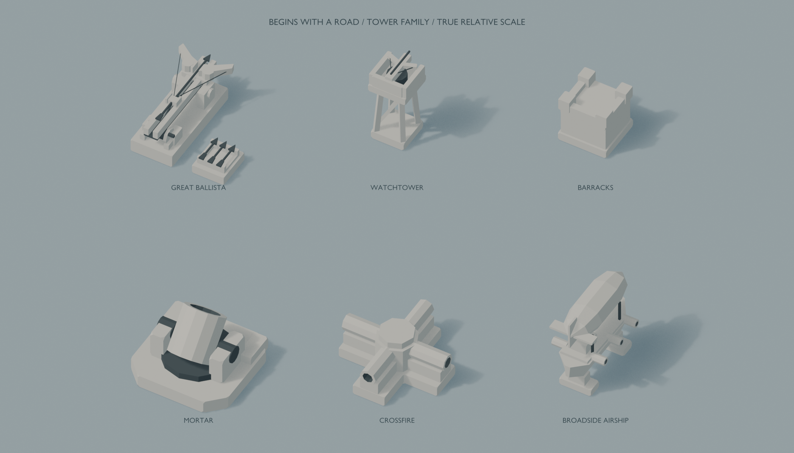
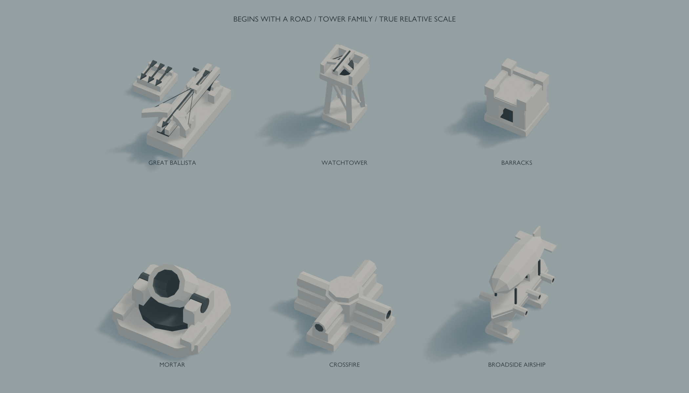

# 防禦塔家族預覽

[完整設計與尺寸規格](model-spec.md)

所有近景採相同尺度；遊戲圖為1280×800、正交跨度18.5，未裁切放大。

## Watchtower

[Blender](<watchtower/model.blend>) · [GLB](<watchtower/watchtower.glb>) · [Python](<watchtower/build.py>)

[遊戲正交尺度](<watchtower/previews/game.png>)

## Barracks

[Blender](<barracks/model.blend>) · [GLB](<barracks/barracks.glb>) · [Python](<barracks/build.py>)

[遊戲正交尺度](<barracks/previews/game.png>)

## Mortar

[Blender](<mortar/model.blend>) · [GLB](<mortar/mortar.glb>) · [Python](<mortar/build.py>)

[遊戲正交尺度](<mortar/previews/game.png>)

## Crossfire

[Blender](<crossfire/model.blend>) · [GLB](<crossfire/crossfire.glb>) · [Python](<crossfire/build.py>)

[遊戲正交尺度](<crossfire/previews/game.png>)

## Broadside Airship

[Blender](<broadside_airship/model.blend>) · [GLB](<broadside_airship/broadside_airship.glb>) · [Python](<broadside_airship/build.py>)

[遊戲正交尺度](<broadside_airship/previews/game.png>)
